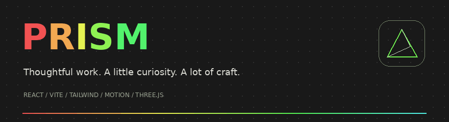
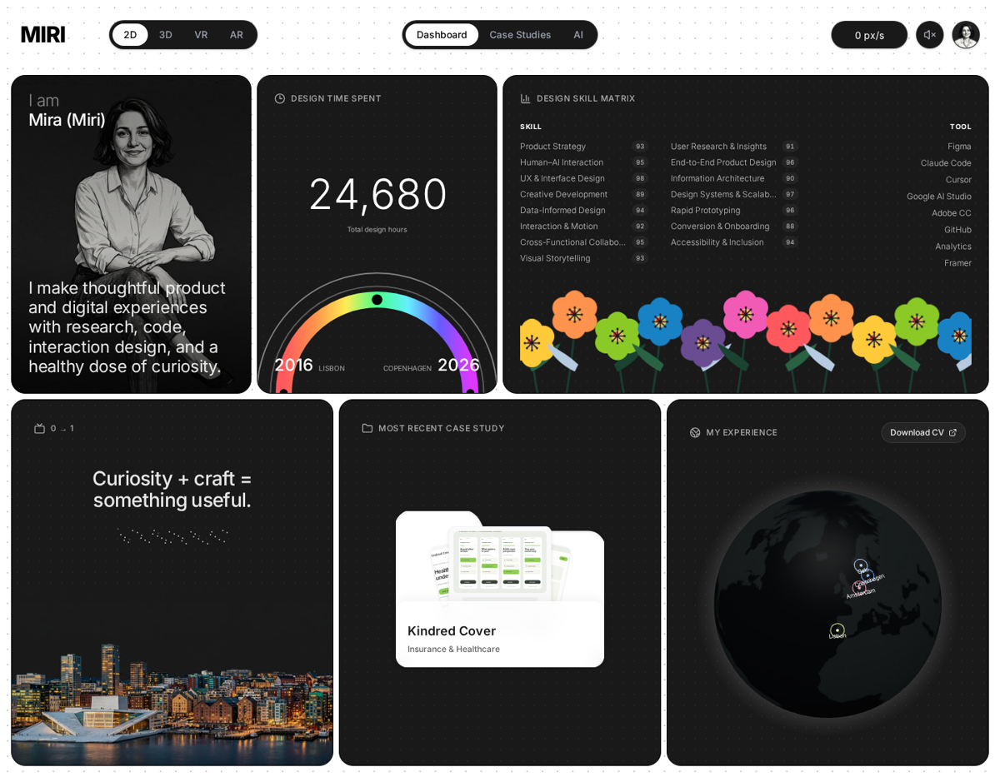
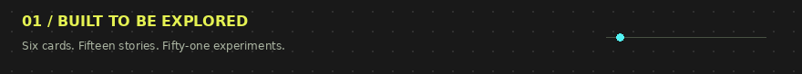
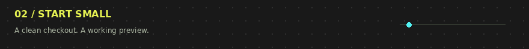
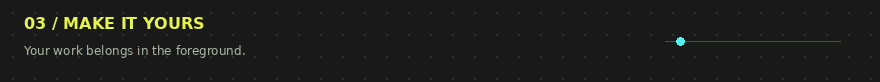

<p align="center">
  
</p>

<h1 align="center">Prism Portfolio</h1>
<p align="center">A playful, considered portfolio template for people who care about the details.</p>
<p align="center"><strong>React</strong> · <strong>Vite</strong> · <strong>Tailwind CSS</strong> · <strong>Framer Motion</strong> · <strong>Three.js</strong></p>
<p align="center"><a href="#features">Explore</a> · <a href="#quick-start">Run locally</a> · <a href="#customisation">Make it yours</a> · <a href="#deployment">Publish</a> · <a href="docs/ASSETS.md">Asset credits</a></p>



> **An editable demo, not a borrowed identity.** Mira Sol is fictional. The concept projects, experience entries, design-hour counter and research figures are illustrative. Replace them with your own work before publishing a personal portfolio.

## Features



- **A six-card bento dashboard** with a monochrome portrait, pointer-driven hour counter, rainbow gauge, interactive flower garden, waterfront artwork, kinetic project folder and experience globe.
- **15 case-study concepts** with original visual assets, research sections, snapshot tabs, process views, full-screen visuals, previous/next navigation and working local prototypes.
- **51 original motion experiments** with category filters, full-screen exploration, pause/play, accent-colour controls and animation tempo.
- **An editorial profile** with original writing, rotating studio notes, scrolling book covers, downloadable demo CV and a reading overlay.
- **A native interactive design roadmap** with hover, focus and touch explanations; plus a draggable, restackable work wall.
- **2D, 3D, VR-style and camera-backed AR views**, a typographic intro, pointer-speed display, rainbow cursor trail, studio audio and scroll-to-top control.
- **Responsive layouts**, labelled controls, keyboard-operable dialogs, focus trapping, reduced-motion handling and hash-based navigation suitable for GitHub Pages.
- **Self-hosted assets and fonts.** No paid API, API key, external video host or music subscription is required.

### Viewing modes, honestly described

| Mode | What it does                                                                                  |
| ---- | --------------------------------------------------------------------------------------------- |
| 2D   | The default flat layout                                                                       |
| 3D   | Spring-smoothed, pointer-driven perspective and layered card content                          |
| VR   | An immersive **visual** treatment with scale and vignette; not a WebXR headset session        |
| AR   | A camera background after you explicitly choose AR and grant permission; not world-tracked AR |

Camera access requires a compatible camera-equipped browser over HTTPS or localhost. An embedded preview may block camera access; open the site in its own browser tab. Denied access gets a clear fallback. Globe rendering requires WebGL.

## Quick start



Use **Node.js 22 LTS**, or Node.js 20.19+.

```bash
npm ci
npm run dev
```

Open the URL printed by Vite, normally `http://localhost:5173`.

```bash
npm test          # Validate demo content and local assets
npm run build    # Create the production site in dist/
npm run preview  # Preview that build, normally on port 4173
```

Do not double-click the source `index.html`: JSX and dependencies need the Vite server or a production build.

## Customisation



Start with **[`src/content.js`](src/content.js)**. It contains the identity, biography, email, tools, skills, projects, map locations, studio notes, books, articles, experiments and roadmap content.

| Change                                | Edit                                                                  |
| ------------------------------------- | --------------------------------------------------------------------- |
| Name, wordmark, bio, email and links  | `profile` in `src/content.js`                                         |
| Case-study text, colours and research | `projectSeeds` in `src/content.js`                                    |
| Project screenshots                   | `public/projects/`, then update each project’s `images`               |
| Portrait and avatar                   | `public/images/portrait.webp`, `profile.webp`, `avatar.webp`          |
| Waterfront illustration               | `public/images/skyline.webp`                                          |
| CV download                           | Replace `public/mira-sol-demo-cv.pdf`; update `profile.cv` if renamed |
| Globe locations and role descriptions | `locations` in `src/content.js`                                       |
| Gallery content and motion            | `experiments` in `src/content.js` and `MotionScene.jsx`               |
| Layout, colours and breakpoints       | `src/styles.css`                                                      |
| Title, SEO and sharing metadata       | `index.html` and `public/images/social-card.png`                      |

**Before publishing:** replace the example email, fictional professional details and demonstration CV. Use only project images and client work you are authorised to publish. Update your production sharing-image URL in the Open Graph metadata.

### Project structure

```text
prism-portfolio/
├── .github/workflows/deploy.yml  # Builds and publishes to GitHub Pages
├── .gitignore
├── index.html
├── package.json
├── package-lock.json
├── vite.config.js               # Relative base paths for project Pages sites
├── src/
│   ├── App.jsx
│   ├── content.js               # Your editable content
│   ├── styles.css
│   ├── components/
│   └── lib/
├── public/
│   ├── fonts/                   # Local WOFF2 files and font licenses
│   ├── images/                  # Original demo imagery
│   ├── projects/                # Original SVG interface concepts
│   └── mira-sol-demo-cv.pdf
├── tests/content.test.mjs
├── scripts/create-assets.py     # Optional asset-maintenance utility
└── docs/
```

The optional Python asset script uses Pillow and downloads licensed fonts and public-domain map outlines. You do **not** need Python to run, build, deploy or customise the portfolio. All required assets are already included.

## Engineering notes

- React 18.3.1; Vite 7.1.9; Tailwind 4.2.4; Framer Motion 12.23.24; Three.js 0.185.0; `react-globe.gl` 2.38.0.
- The lockfile and Motion overrides keep the tested dependency set reproducible.
- Larger views and the globe are lazy-loaded. The WebGL globe is the largest download; no external imagery is fetched at runtime.
- Hash routes allow direct links and refreshes without a Pages server rewrite.
- The local prototypes are demonstrations: they do not send data, create accounts, charge money or provide professional advice.
- The gallery uses original React/CSS/SVG motion studies in place of the reference’s remote media.

## Design provenance & license

This is an independently implemented, reference-informed recreation of the layout and interaction patterns studied at [Zalak Patel’s portfolio](https://www.zalak-patel.com/). It is **not** the reference’s original source code, a certified pixel-perfect copy, or an endorsed derivative. The reference’s identity, client assets and award badge are not included.

The portrait and waterfront artwork were AI-generated specifically for this fictional demo; the SVG project interfaces, book-cover artwork, text, animation code and README GIFs are original template material. Fonts and map-outline sources retain their own licenses. See [asset provenance](docs/ASSETS.md) and [implementation scope](docs/IMPLEMENTATION.md).

**MIT-licensed code.** See [LICENSE](LICENSE). Inter and Playfair Display are supplied under the SIL Open Font License, with license files included.

---

<p align="center"><strong>Make the useful thing a beautiful thing.</strong><br /><sub>Prism / An open portfolio template</sub></p>

<div align="center">

## 🌟 Support the Project

If you find this template useful, please consider giving it a star! It helps others discover the repository and supports future development.

</div>
